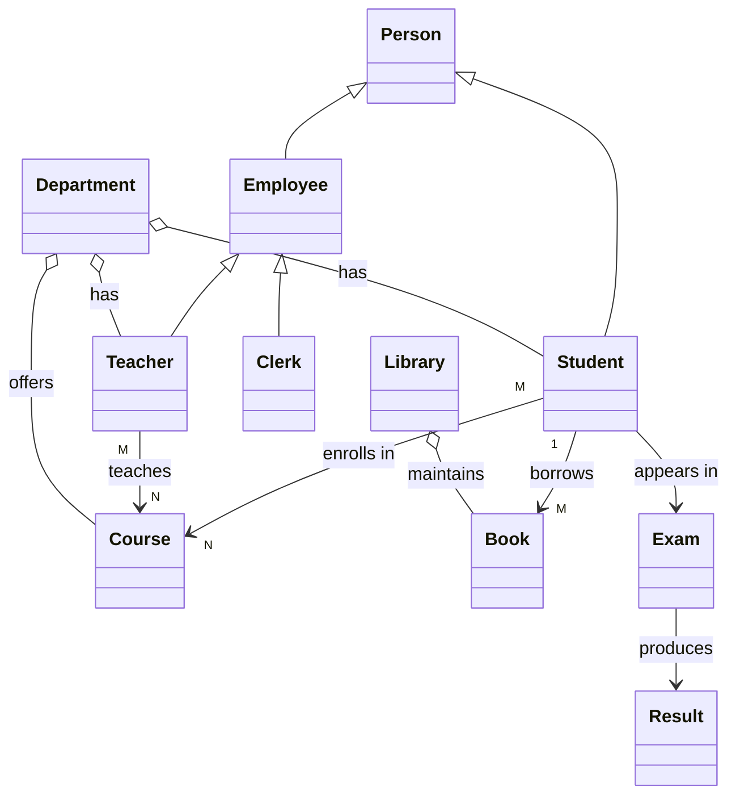
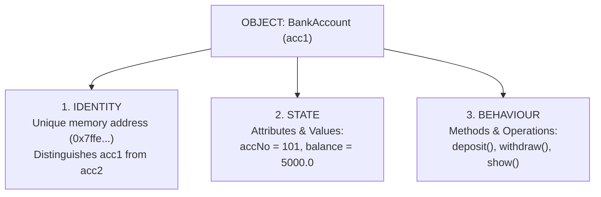
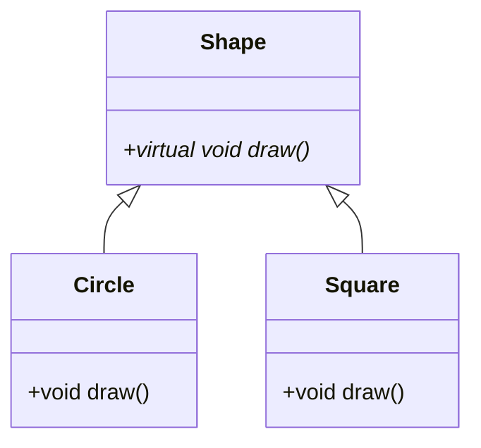

# OOPM Exam Answers
> **Model Answers for Object-Oriented Programming & Methodology**  
> **Date:** October 14, 2026 | **Subject:** Object-Oriented Programming & Methodology (OOPM)  
> **Language:** C++ | **Standard:** ISO/IEC C++11 and above  

---

## Quick Navigation / Index

- [Part I](#part-i)
  - [Question 1 A: Why OOP is Closer to Real-World Problem Solving (College Management System)](#question-1-a-why-oop-is-closer-to-real-world-problem-solving)
  - [Question 1 B: Function Overloading vs Constructor Overloading](#question-1-b-function-overloading-and-constructor-overloading)
  - [Question 2 A: Object Model, Identity, State & Behaviour](#question-2-a-everything-in-oop-revolves-around-objects)
  - [Question 2 B: Shared Class Definition with Individual Object States](#question-2-b-student-class-shared-definition-vs-individual-state)
  - [Question 3 A: Inline Functions & Inline vs Normal Function Calls](#question-3-a-inline-functions-square--cube-and-call-overhead)
  - [Question 3 B: Major Features of OOP & Building Large Systems](#question-3-b-major-features-of-the-object-oriented-paradigm)
  - [Question 4: Comprehensive C++ Program (Class, Object, Constructor, Destructor, Inline, Arguments)](#question-4-comprehensive-c-application)
- [Part II](#part-ii)
  - [Question 5 A: Class vs Object](#question-5-a-differentiate-between-a-class-and-an-object)
  - [Question 5 B: Why a Constructor is Required](#question-5-b-why-a-constructor-is-required-in-a-class)
  - [Question 6 A: Static Data Members & Member Functions (Student Counter)](#question-6-a-static-data-members-and-static-member-functions)
  - [Question 6 B: Access Modifiers (private, public, protected) & Encapsulation](#question-6-b-access-modifiers-encapsulation-and-data-hiding)
  - [Question 7 A: Employee Class: Instance Members vs Static Members](#question-7-a-employee-class-instance-vs-static-members)
  - [Question 8: Construction & Destruction Sequence in a Block (BankAccount)](#question-8-construction-and-destruction-sequence-of-objects)

---

# Part I

---

## Question 1 A: Why OOP is Closer to Real-World Problem Solving

### Definition & Core Concept
**Object-Oriented Programming (OOP)** models software as a collection of interacting objects, each bundling data (attributes) and functions (behaviours), exactly as real-world entities do. In contrast, **Procedural Programming** models a program as a sequence of procedures (functions) operating on detached, shared data structures.

---

### Why OOP is Closer to the Real World (Key Characteristics)

1. **Problem Domain Maps Directly to Code:** A real-world *Student*, *Teacher*, or *Course* becomes a class with the identical name and characteristics, making the software mirror reality.
2. **Data + Behaviour Together (Encapsulation):** A student possesses a name and performs the action of registering. OOP bundles both into a unified capsule. Procedural programming keeps data in structs and functions detached elsewhere.
3. **Data Hiding & Security:** Real objects hide internal mechanisms (e.g., one cannot directly manipulate another person's exam marks). OOP uses `private` members; procedural systems expose shared global variables.
4. **Natural Hierarchies (Inheritance):** Real life is inherently hierarchical (*Professor* is an *Employee*; *Student* is a *Person*). OOP represents this with base and derived classes.
5. **Same Message, Different Response (Polymorphism):** Calling `calculatePay()` produces distinct behaviours for a *Professor* versus an administrative *Clerk*.
6. **Bottom-Up Design and Reusability:** Small, robust, self-contained objects are built first and composed into sophisticated systems.
7. **Maintainability & Extensibility:** Adding a new entity (e.g., *Hostel*) simply introduces a new class without disturbing existing, tested code.

---

### Real-World Entities of a College Management System

| No. | Entity (Class) | Attributes (Data Members) | Behaviours (Member Functions) | Relationships |
|:---:|:---|:---|:---|:---|
| **1** | `Student` | `rollNo`, `name`, `address`, `semester`, `marks` | `register()`, `payFees()`, `viewResult()` | Enrolls in `Course`; belongs to `Department`; borrows `Book` |
| **2** | `Teacher` / `Professor` | `empId`, `name`, `designation`, `salary` | `teach()`, `setQuestionPaper()`, `markAttendance()` | Teaches `Course`; works in `Department` |
| **3** | `Course` | `courseCode`, `title`, `credits` | `addStudent()`, `getSyllabus()` | Taught by `Teacher`; taken by many `Student`s (M:N) |
| **4** | `Department` | `deptId`, `deptName` | `addFaculty()`, `listCourses()` | Has many `Teacher`s, `Student`s, `Course`s (Aggregation) |
| **5** | `Library` | `libId`, `bookCount` | `issueBook()`, `returnBook()`, `calculateFine()` | Manages `Book`s; serves `Student`s and `Teacher`s |
| **6** | `Book` | `isbn`, `title`, `author`, `status` | `issue()`, `return()` | Belongs to `Library`; issued to `Student` |
| **7** | `Exam` | `examId`, `date`, `maxMarks` | `schedule()`, `evaluate()` | Conducted for `Course`; generates `Result` |
| **8** | `Result` / `Marksheet`| `rollNo`, `subjectMarks`, `grade` | `computeGrade()`, `printMarksheet()` | Belongs to `Student` for a specific `Exam` |
| **9** | `FeeAccount` | `accountNo`, `amountDue`, `amountPaid` | `payFees()`, `generateReceipt()` | One-to-one per `Student` |
| **10**| `HostelRoom` | `roomNo`, `capacity`, `occupants` | `allocateRoom()`, `vacate()` | `Student`s allocated to `HostelRoom` |

---

### Class Relationships Diagram

#### Visual Mermaid Diagram


#### ASCII Diagram
```text
            Person (base class)
            /                \
        Student            Employee
           |               /      \
           |          Teacher     Clerk
           |             |
  enrolls in (M:N)   teaches (M:N)
           \            /
               Course
                  |
        offered by (aggregation)
                  |
             Department  ----has----> Teachers, Students

   Student --borrows--> Book <--belongs to-- Library
   Student --appears in--> Exam --produces--> Result
```

---

### Syntax & Class Representation
```cpp
class ClassName {
  access_specifier:
     data_members;       // attributes / state
     member_functions(); // behaviours / methods
};
```

---

### C++ Code Example
```cpp
#include <iostream>
#include <string>
using namespace std;

class Student {                 // Real-world entity -> Class
private:                        // Data hiding (attributes encapsulated)
    int rollNo;
    string name;
public:
    Student(int r, string n) : rollNo(r), name(n) {}

    void register_for(string course) {            // Behaviour
        cout << name << " (Roll " << rollNo << ") registered for " << course << endl;
    }
};

class Teacher {
private:
    string name;
public:
    Teacher(string n) : name(n) {}

    void teach(string course) {                   // Behaviour
        cout << name << " teaches " << course << endl;
    }
};

int main() {
    Student s(101, "Asha");     // Object = concrete real-world student
    Teacher t("Dr. Rao");       // Object = concrete real-world teacher

    t.teach("OOPM");
    s.register_for("OOPM");     // Objects interact via message passing
    return 0;
}
```

---

### Real-World Analogy
In a real university campus, the **Student**, **Professor**, and **Librarian** are distinct, autonomous entities that collaborate by exchanging messages (a student submits a book request; the librarian issues the book). OOP systems operate in the exact same decentralized manner through message passing.

---

### Comparison: Procedural vs Object-Oriented Programming

| Parameter / Basis | Procedural Programming (POP) | Object-Oriented Programming (OOP) |
|:---|:---|:---|
| **Approach** | Top-down design | Bottom-up design |
| **Primary Unit** | Function / Procedure | Class / Object |
| **Data & Functions** | Kept separate; functions manipulate raw data | Bundled together into unified units (Encapsulation) |
| **Data Security** | Weak; global variables exposed to entire codebase | High; access specifiers (`private`/`protected`) hide internals |
| **Real-World Modeling** | Weak; focuses on algorithmic steps | Strong; directly models physical and conceptual entities |
| **Reusability** | Limited; copy-paste or procedural function calls | High; achieved via Inheritance and Composition |
| **Extensibility** | Difficult; modifications cause cascading side effects | Easy; new classes extend system without editing existing code |
| **Polymorphism** | Not supported | Supported (Compile-time & Run-time) |
| **Examples** | C, Pascal, FORTRAN | C++, Java, Python, C# |

---

### Advantages & Disadvantages of OOP

> [!TIP]
> **Advantages:**
> - Intuitive real-world problem domain mapping.
> - High software security through robust data hiding.
> - Excellent code reuse via inheritance and polymorphism.
> - Simplified debugging and maintenance in complex enterprise architectures.

> [!WARNING]
> **Disadvantages / Limitations:**
> - Steeper initial learning curve and architectural planning requirements.
> - Slightly higher memory overhead and runtime cost (e.g., virtual table lookups).
> - Overkill for trivial, one-off utility scripts.

---
---

## Question 1 B: Function Overloading and Constructor Overloading

### Definition & Core Concept
- **Function Overloading:** Defining multiple functions with the **same name** but **different parameter signatures** (different number, type, or order of parameters) within the same scope.
- **Constructor Overloading:** Defining multiple constructors within a single class with varying parameter lists to allow objects to be initialized in different ways.
- Both are forms of **compile-time (static) polymorphism**.

---

### Key Characteristics & Need
- **Resolution mechanism:** The compiler resolves the target function at compile-time using the **function signature** (`name` + `parameter list`).
- **Return Type Rule:** The return type alone is **insufficient** to distinguish overloaded functions.
- **Enhanced Code Readability:** Developers use one intuitive, consistent name (e.g., `area()`, `print()`) instead of arbitrary names (`areaSquare()`, `areaRect()`).
- **Initialization Flexibility:** Constructor overloading allows default initialization, parameterized initialization, and copy initialization.

---

### Syntax & Working

```cpp
// Function Overloading signatures
return_type fname(int a);
return_type fname(double a);          // Different type
return_type fname(int a, int b);      // Different count

// Constructor Overloading signatures inside a class
class C {
public:
    C();             // Default constructor
    C(int x);        // Parameterized constructor (1 argument)
    C(int x, int y); // Parameterized constructor (2 arguments)
    C(const C &c);   // Copy constructor
};
```

---

### C++ Code Example
```cpp
#include <iostream>
using namespace std;

// ================= Function Overloading =================
int    area(int s)            { return s * s; }          // Square
int    area(int l, int b)     { return l * b; }          // Rectangle
double area(double r)         { return 3.14159 * r * r; }// Circle

// ================= Constructor Overloading =================
class Rectangle {
    int length, breadth;
public:
    Rectangle() { length = breadth = 0; }                  // Default
    Rectangle(int s) { length = breadth = s; }             // Square constructor
    Rectangle(int l, int b) { length = l; breadth = b; }   // General constructor
    Rectangle(const Rectangle &r) {                        // Copy constructor
        length = r.length;
        breadth = r.breadth;
    }

    int getArea() { return length * breadth; }
};

int main() {
    // Calling Overloaded Functions
    cout << "Area of square (4): "       << area(4)    << endl; // calls area(int)
    cout << "Area of rectangle (4, 5): " << area(4, 5) << endl; // calls area(int, int)
    cout << "Area of circle (2.5): "     << area(2.5)  << endl; // calls area(double)

    // Using Overloaded Constructors
    Rectangle r1;                   // Default
    Rectangle r2(5);                // 1 argument (Square)
    Rectangle r3(4, 6);             // 2 arguments
    Rectangle r4(r3);               // Copy of r3

    cout << "r1: " << r1.getArea() << " | r2: " << r2.getArea()
         << " | r3: " << r3.getArea() << " | r4: " << r4.getArea() << endl;
    return 0;
}
```

**Output:**
```text
Area of square (4): 16
Area of rectangle (4, 5): 20
Area of circle (2.5): 19.6349
r1: 0 | r2: 25 | r3: 24 | r4: 24
```

---

### Real-World Analogy
Consider the verb **"pay"**: you can pay by cash, credit card, or UPI. The intention remains identical (`pay`), but the inputs (parameters) differ. Similarly, an application form can be submitted blank (default), with personal information filled in (parameterized), or duplicated from an existing profile (copy constructor).

---

### Comparison: Function Overloading vs Constructor Overloading

| Parameter / Basis | Function Overloading | Constructor Overloading |
|:---|:---|:---|
| **Name** | Any valid function identifier | Must strictly match the class name |
| **Return Type** | Can return any type (`int`, `void`, `double`, etc.) | **No return type**, not even `void` |
| **Primary Purpose** | Executes the same logical task on diverse input types | Initializes objects in diverse states |
| **Invocation** | Explicitly called by name in expressions | Automatically invoked by the runtime upon object instantiation |
| **Scope of Occurrence** | Can exist in global namespace or inside a class | Exclusively defined inside a class |

---

### Advantages & Limitations
- **Advantages:** Clean, elegant APIs; elimination of artificial function names; zero runtime performance penalty (resolved entirely at compile time).
- **Limitations:** Cannot overload solely based on differing return types; implicit type coercion can lead to compilation errors due to ambiguity (e.g., calling `f(5)` when both `f(float)` and `f(double)` are defined).

---
---

## Question 2 A: "Everything in OOP Revolves Around Objects"

### Definition & Core Concept
An **object** is a run-time instance of a class representing a real-world entity that encapsulates **Identity**, **State**, and **Behaviour**. The **Object Model** is the conceptual framework in which software is structured as an ecosystem of cooperating objects based on the four fundamental principles established by Grady Booch: **Abstraction, Encapsulation, Modularity, and Hierarchy**.

---

### Why the Statement is Justified
1. **Objects are the Sole Execution Units:** Classes are merely blueprints; no actual memory is allocated or computation performed until objects are instantiated.
2. **Encapsulation of Entire System Logic:** Data and operations live inside objects rather than free-floating in global space.
3. **Emergence via Collaboration:** System-wide behaviour emerges from objects sending messages to one another, not from a single monolithic main routine.
4. **All OOP Principles Apply to Objects:** Polymorphism, inheritance, and dynamic binding exist exclusively to govern how objects interact.

---

### The Three Essential Properties of an Object



| Property | Definition | Bank Account Example |
|:---|:---|:---|
| **Identity** | The unique handle/memory address that distinguishes an object from all other objects, even if their data values are identical. | `acc1` and `acc2` remain distinct objects residing at separate memory addresses, even if both hold ₹5,000. |
| **State** | The cumulative set of values stored in the object's data members at a specific moment in time. State is dynamic. | `accNo = 101`, `holder = "Ravi"`, `balance = 5000.00` |
| **Behaviour** | The member functions defining the operations the object can execute to inspect or alter its state. | `deposit()`, `withdraw()`, `checkBalance()` |

---

### Core Principles of the Object Model
- **Abstraction:** Hiding low-level implementation details and exposing only essential functional characteristics.
- **Encapsulation:** Enclosing state and behaviour inside a protective boundary, preventing unauthorized direct access.
- **Modularity:** Partitioning software into cohesive, loosely coupled compilation units (classes).
- **Hierarchy:** Organizing abstractions into structured ranks (Inheritance = "is-a", Aggregation = "has-a").

---

### C++ Code Example: Demonstrating Identity, State, and Behaviour
```cpp
#include <iostream>
using namespace std;

class BankAccount {
private:
    int accNo;          // Part of STATE
    double balance;     // Part of STATE

public:
    BankAccount(int n, double b) : accNo(n), balance(b) {}

    // BEHAVIOUR altering STATE
    void deposit(double amt) {
        if (amt > 0) balance += amt;
    }

    // BEHAVIOUR reading STATE
    void show() const {
        cout << "Acc: " << accNo << " | Balance: ₹" << balance << endl;
    }
};

int main() {
    // Two objects instantiated with identical state
    BankAccount a1(101, 5000.0);
    BankAccount a2(102, 5000.0);

    // Demonstration of IDENTITY
    cout << "Address of a1: " << &a1 << endl;
    cout << "Address of a2: " << &a2 << endl;
    cout << "Identity check: " << (&a1 == &a2 ? "Identical" : "Distinct Objects") << endl;

    // Mutating a1's state does not affect a2
    a1.deposit(1500.0);

    cout << "\nAfter depositing to a1:" << endl;
    a1.show(); // Acc: 101 | Balance: ₹6500
    a2.show(); // Acc: 102 | Balance: ₹5000 (unaltered)

    return 0;
}
```

---

### Real-World Analogy
Consider a **Motor Car**:
- **Identity:** The VIN (Vehicle Identification Number) or License Plate number. Two identical red Tesla Model 3 cars off the assembly line have unique identities.
- **State:** Current speed (60 km/h), fuel level (80%), selected gear (4th).
- **Behaviour:** `accelerate()`, `applyBrakes()`, `steer()`.

---
---

## Question 2 B: Student Class: Shared Definition vs Individual State

### Definition & Core Concept
A **class** is a user-defined blueprint defining attributes and member functions once. Each instantiated **object** receives its own private memory allocation for **data members** (individual state), while **member functions** are stored once in the shared code segment and invoked on behalf of objects via the implicit `this` pointer.

---

### C++ Code Example
```cpp
#include <iostream>
#include <string>
using namespace std;

class Student {
private:
    string name;       // Individual copy per object
    int rollNo;        // Individual copy per object
    float marks;       // Individual copy per object

public:
    void setData(string n, int r, float m) {
        name = n;
        rollNo = r;
        marks = m;
    }

    void display() const {
        cout << "Name: " << name << "\t| Roll: " << rollNo << "\t| Marks: " << marks << endl;
    }
};

int main() {
    // One class definition, three distinct object instances
    Student s1, s2, s3;

    s1.setData("Asha", 1, 82.5f);
    s2.setData("Ravi", 2, 74.0f);
    s3.setData("Meera", 3, 91.0f);

    s1.display();
    s2.display();
    s3.display();

    return 0;
}
```

**Terminal Output:**
```text
Name: Asha  | Roll: 1   | Marks: 82.5
Name: Ravi  | Roll: 2   | Marks: 74
Name: Meera | Roll: 3   | Marks: 91
```

---

### Memory Architecture

```text
  SHARED CODE SEGMENT (Read-Only Memory)
  +------------------------------------------------+
  | Student::setData()        Student::display()   |
  +------------------------------------------------+
             ^                   ^
             | (Invoked via      | (Passed via
             |  'this' pointer)  |  hidden 'this')
             |                   |
  STACK / HEAP MEMORY (Independent Object States)
  +------------------------------------------------+
  | Object s1 (0x1000): ["Asha"  | roll: 1 | 82.5] |
  | Object s2 (0x1040): ["Ravi"  | roll: 2 | 74.0] |
  | Object s3 (0x1080): ["Meera" | roll: 3 | 91.0] |
  +------------------------------------------------+
```

---

### Technical Explanation
- **Data Member Multiplication:** If `Student` is instantiated 10,000 times, 10,000 independent copies of `name`, `rollNo`, and `marks` reside in RAM. Modifying `s1.marks` will never corrupt `s2.marks`.
- **Code Economy:** Member function instructions exist **exactly once** in executable memory. When `s2.display()` is called, the compiler translates this to `Student::display(&s2)`, passing the address of `s2` as the hidden `this` pointer.

---
---

## Question 3 A: Inline Functions (Square & Cube) and Call Overhead

### Definition & Core Concept
An **inline function** is a function declared with the `inline` keyword. It directs a suggestion to the compiler to substitute the actual function body directly at each call site (inline expansion) during compilation, thereby eliminating the runtime overhead of a standard function call.

---

### Function Call Overhead in Normal Functions
A standard function call requires machine-level operations:
1. Pushing arguments onto the program call stack.
2. Saving the CPU return instruction pointer.
3. Allocating a new stack activation frame.
4. Jumping execution control to the function's memory address.
5. Executing the body and placing the return value in a register.
6. Unwinding the stack frame and jumping back to the caller.

For tiny operations (such as computing `x * x`), this overhead takes more CPU cycles than the calculation itself. Inlining removes this overhead entirely.

---

### C++ Code Example
```cpp
#include <iostream>
using namespace std;

// Inline function definitions
inline int square(int n) {
    return n * n;
}

inline int cube(int n) {
    return n * n * n;
}

int main() {
    int num;
    cout << "Enter an integer: ";
    if (cin >> num) {
        cout << "Square of " << num << " = " << square(num) << endl;
        cout << "Cube of "   << num << " = " << cube(num)   << endl;
    }
    return 0;
}
```

**Conceptual Expansion by Compiler:**
```cpp
// Source Code:
cout << square(num);

// After inline expansion (no stack push, no jump):
cout << (num * num);
```

---

### Comparison: Inline Function vs Normal Function Call

| Basis / Parameter | Inline Function | Normal Function Call |
|:---|:---|:---|
| **Mechanism** | Function code is expanded directly at the call site | CPU jumps to subroutine address, executes, and returns |
| **Execution Speed** | Faster for small routines (zero invocation overhead) | Slower due to stack frame creation and jumps |
| **Stack Overhead** | No stack frame allocated | Uses stack memory for parameters and return addresses |
| **Executable Size** | May increase binary size if called extensively (code bloat) | Compact binary (single instance of compiled machine code) |
| **Compiler Status** | Treated as a **request/hint**; compiler may refuse | Always compiled as an out-of-line subroutine call |
| **Suitable Scenarios** | Tiny (1–3 lines), heavily called accessor/math functions | Large routines, recursive calls, functions with loops/switch |
| **Debugging** | Harder to trace breakpoints inside inlined expressions | Straightforward step-in debugging |

---

### Rules & Limitations
- **Compilers Reject Inlining If:** The function contains recursion, loops (`for`, `while`), `switch` blocks, `static` variables, or if the program takes the function's address via a function pointer.
- **Code Bloat:** Excessive inlining of large functions degrades CPU instruction cache (L1 cache) performance.

---
---

## Question 3 B: Major Features of the Object-Oriented Paradigm

### Definition & Overview
The **Object-Oriented Paradigm** is an architectural approach organizing software systems as collections of autonomous, cooperating objects. It provides 8 major structural pillars:

1. **Classes & Objects:** Classes are formal blueprints; objects are dynamic, stateful instances.
2. **Data Abstraction:** Exposing critical interface features while concealing internal mechanics.
3. **Encapsulation:** Wrapping attributes and member functions into a single cohesive boundary.
4. **Data Hiding:** Protecting sensitive data members through access specifiers (`private`).
5. **Inheritance:** Deriving new classes from existing classes to achieve hierarchical code reuse.
6. **Polymorphism:** A single interface executing diverse logic based on the calling object (Compile-time & Run-time).
7. **Dynamic Binding:** Resolving target function code dynamically at runtime via virtual function tables (`vtable`).
8. **Message Passing:** Objects communicating by calling public member functions on other objects.

---

### Inheritance & Polymorphism Hierarchy



---

### C++ Code Example: Inheritance and Run-Time Polymorphism
```cpp
#include <iostream>
#include <vector>
using namespace std;

// Base Class (Abstraction)
class Shape {
public:
    virtual void draw() const {            // Virtual function for Dynamic Binding
        cout << "Drawing generic Shape" << endl;
    }
    virtual ~Shape() {}                    // Virtual destructor
};

// Derived Classes (Inheritance)
class Circle : public Shape {
public:
    void draw() const override {           // Run-time Polymorphism
        cout << "Drawing Circle (O)" << endl;
    }
};

class Square : public Shape {
public:
    void draw() const override {
        cout << "Drawing Square ([])" << endl;
    }
};

int main() {
    Circle c;
    Square s;

    // Polymorphic pointers (Dynamic Binding)
    Shape* shapes[] = { &c, &s };

    for (Shape* shapePtr : shapes) {
        shapePtr->draw(); // Correct derived method resolved at runtime
    }

    return 0;
}
```

---

### How OOP Features Enable Building Large Enterprise Systems

| OOP Feature | Direct Practical Benefit for Complex Systems |
|:---|:---|
| **Encapsulation & Data Hiding** | Prevents unintended global mutations; changes within a class do not break client code. |
| **Abstraction** | Tames cognitive overload; engineers work with high-level clean contracts without mastering sub-system internals. |
| **Inheritance** | Eliminates code duplication by reusing tested base-class logic across specialized variants. |
| **Polymorphism & Dynamic Binding** | Enforces the Open/Closed Principle: open for extension, closed for modification. New plugins/types are added without editing core engine code. |
| **Modularity** | Enables distributed engineering teams to write, test, and maintain isolated modules in parallel. |
| **Message Passing** | Produces loosely coupled systems where components interact exclusively through well-defined APIs. |

---
---

## Question 4: Comprehensive C++ Application
*(Class, Object, Constructor, Destructor, Inline Function, Formal and Actual Arguments)*

### Overview
The following program encapsulates a complete geometric `Rectangle` model demonstrating every fundamental OOP building block in a single working compilation unit.

---

### Complete C++ Program
```cpp
#include <iostream>
using namespace std;

// ====================== CLASS: Architectural Blueprint ======================
class Rectangle {
private:
    int length;   // Encapsulated data member
    int breadth;  // Encapsulated data member

public:
    // ==================== CONSTRUCTOR (Formal Parameters: l, b) ====================
    Rectangle(int l, int b) {
        length = l;
        breadth = b;
        cout << "[Constructor] Rectangle initialized: (" << length << " x " << breadth << ")" << endl;
    }

    // ==================== INLINE MEMBER FUNCTION ====================
    // Defined inside the class body; implicitly suggested as inline
    inline int area() const {
        return length * breadth;
    }

    // ==================== MEMBER FUNCTION (Formal Parameter: factor) ====================
    void scale(int factor) {
        length  *= factor;
        breadth *= factor;
    }

    void display() const {
        cout << "Rectangle: " << length << " x " << breadth 
             << " | Area = " << area() << endl;
    }

    // ==================== DESTRUCTOR ====================
    ~Rectangle() {
        cout << "[Destructor] Rectangle destroyed: (" << length << " x " << breadth << ")" << endl;
    }
};

int main() {
    cout << "=== Main Execution Started ===" << endl;

    // 1. OBJECT INSTANTIATION: r1 created with ACTUAL arguments (4, 5)
    Rectangle r1(4, 5);
    r1.display();

    // 2. ACTUAL ARGUMENT PASSED TO FUNCTION
    int scaleFactor = 2; // Actual argument
    r1.scale(scaleFactor);
    cout << "After scaling by " << scaleFactor << ":" << endl;
    r1.display();

    // 3. SECOND OBJECT INSTANTIATION: r2 created with ACTUAL arguments (2, 3)
    Rectangle r2(2, 3);
    r2.display();

    cout << "=== Main Terminating (Objects will exit scope) ===" << endl;
    return 0; // Automatic destruction of r2 first, then r1 (LIFO)
}
```

---

### Output
```text
=== Main Execution Started ===
[Constructor] Rectangle initialized: (4 x 5)
Rectangle: 4 x 5 | Area = 20
After scaling by 2:
Rectangle: 8 x 10 | Area = 80
[Constructor] Rectangle initialized: (2 x 3)
Rectangle: 2 x 3 | Area = 6
=== Main Terminating (Objects will exit scope) ===
[Destructor] Rectangle destroyed: (2 x 3)
[Destructor] Rectangle destroyed: (8 x 10)
```

---

### Concept Verification Matrix

| Concept | Location in Code | Architectural Role |
|:---|:---|:---|
| **Class** | `class Rectangle { ... };` | User-defined type encapsulating attributes (`length`, `breadth`) and methods. |
| **Object** | `Rectangle r1(4, 5);`, `r2(2, 3);` | Concrete run-time instances occupying memory with independent state. |
| **Constructor** | `Rectangle(int l, int b)` | Automatic initializer guaranteeing valid state upon object instantiation. |
| **Destructor** | `~Rectangle()` | Automatic cleanup handler triggered as objects leave stack scope. |
| **Inline Function**| `inline int area() const` | Body substituted at call sites to eliminate function invocation overhead. |
| **Formal Arguments**| `int l, int b` in constructor; `int factor` in `scale()` | Placeholders defined in function declarations to receive passed data. |
| **Actual Arguments**| `4, 5` passed to `r1`; `scaleFactor` passed to `r1.scale()` | Concrete values/variables provided by the caller at point of invocation. |

---

### Parameter Passing Mechanism
```text
  CALL SITE:         r1.scale( scaleFactor );     scaleFactor = 2   <-- ACTUAL ARGUMENT
                                     |
                       (Pass-by-Value: Copied)
                                     v
  FUNCTION HEADER:   void scale( int factor )     factor = 2        <-- FORMAL PARAMETER
```

---
---

# Part II

---

## Question 5 A: Differentiate Between a Class and an Object

### Definition & Core Concept
- **Class:** A user-defined data type and conceptual blueprint specifying the attributes and member functions shared by all instances of that category.
- **Object:** A concrete, run-time instance created from a class blueprint that occupies physical memory space and holds live state.

---

### Detailed Comparison Table

| Basis of Comparison | Class | Object |
|:---|:---|:---|
| **Fundamental Nature** | Logical abstraction / Type definition | Physical entity / Run-time instance |
| **Memory Allocation** | Consumes **no memory** for data members upon definition | Consumes **physical RAM** for data members upon instantiation |
| **Identity** | Has only a type name; no individual runtime identity | Possesses unique runtime identity (memory address / variable name) |
| **State / Values** | Specifies attributes without storing concrete values | Holds concrete runtime values in its private data members |
| **Member Functions** | Defined once as part of the class specification | Shares the single compiled code body via implicit `this` pointer |
| **Lifetime** | Persists throughout compilation and execution | Exists from constructor execution until destructor cleanup |
| **Creation Method** | Declared using the `class` keyword | Instantiated on stack (`Class obj;`) or heap (`new Class;`) |
| **Cardinality** | Defined once per problem domain | Can be instantiated any arbitrary number of times |
| **Real-World Analogy** | Architectural blueprint of a villa | A physical house constructed at 12 Baker Street |

---

### C++ Code Example
```cpp
#include <iostream>
#include <string>
using namespace std;

// CLASS: Blueprint (Zero data memory consumed)
class Car {
public:
    string brand;
    int speed;

    void display() const {
        cout << brand << " travelling at " << speed << " km/h" << endl;
    }
};

int main() {
    // OBJECT 1: Stack allocation
    Car c1;
    c1.brand = "Honda";
    c1.speed = 80;

    // OBJECT 2: Heap allocation
    Car* c2 = new Car();
    c2->brand = "Tata";
    c2->speed = 65;

    c1.display();
    c2->display();

    cout << "Size of object c1: " << sizeof(c1) << " bytes" << endl;

    delete c2; // Cleanup heap object
    return 0;  // c1 stack memory freed automatically
}
```

---
---

## Question 5 B: Why a Constructor is Required in a Class

### Definition & Core Concept
A **constructor** is a specialized member function bearing the identical name as its class and possessing **no return type** (not even `void`). It is executed automatically by the C++ runtime system whenever an object instance is created.

---

### Core Reasons Why Constructors are Mandatory

1. **Guaranteed Elimination of Garbage Values:** Primitive variables allocated on the stack default to arbitrary memory junk. A constructor guarantees deterministic initialization.
2. **Deterministic Object Validity:** Prevents objects from ever existing in an illegal, half-formed, or inconsistent state (e.g., negative bank balances).
3. **Automated Resource Acquisition (RAII):** Allocates heap memory (`new`), opens file streams, or establishes database connections at the exact instant of creation.
4. **Convenient Initialization Overloads:** Enables client code to instantiate objects through multiple forms (default, parameterized, copy).

---

### Types of Constructors

| Constructor Variant | Standard Signature | Primary Purpose |
|:---|:---|:---|
| **Default Constructor** | `ClassName()` | Initializes data members to safe zero/empty defaults without arguments. |
| **Parameterized Constructor** | `ClassName(arg1, arg2...)` | Initializes data members with custom caller-provided values. |
| **Copy Constructor** | `ClassName(const ClassName &obj)` | Initializes a new object as a deep/shallow clone of an existing object. |

---

### C++ Code Example
```cpp
#include <iostream>
#include <string>
using namespace std;

class Account {
private:
    int accNo;
    double balance;

public:
    // 1. Default Constructor
    Account() : accNo(0), balance(0.0) {
        cout << "Default constructor invoked." << endl;
    }

    // 2. Parameterized Constructor
    Account(int n, double b) : accNo(n), balance(b) {
        cout << "Parameterized constructor invoked for Acc " << accNo << endl;
    }

    // 3. Copy Constructor
    Account(const Account &other) : accNo(other.accNo + 1000), balance(other.balance) {
        cout << "Copy constructor invoked from Acc " << other.accNo << endl;
    }

    void display() const {
        cout << "Acc: " << accNo << " | Balance: ₹" << balance << endl;
    }
};

int main() {
    Account a1;              // Default
    Account a2(101, 7500.0); // Parameterized
    Account a3(a2);          // Copy

    a1.display();
    a2.display();
    a3.display();

    return 0;
}
```

---
---

## Question 6 A: Static Data Members and Static Member Functions

### Definition & Core Concept
- **Static Data Member:** A class-level variable declared with the `static` keyword. Only **one single copy** exists in the data segment for the entire class, shared universally by all instantiated objects.
- **Static Member Function:** A class-level function declared with `static`. It can only access static data members, lacks an implicit `this` pointer, and can be invoked directly through the class scope (`ClassName::method()`) without needing any object.

---

### Key Technical Rules
- Static data members are declared inside the class but **must be explicitly defined and allocated outside the class** in a source file using the scope resolution operator (`::`).
- Static members exist even when zero objects of the class have been instantiated.

---

### C++ Code Example: Live Student Tracking Counter
```cpp
#include <iostream>
#include <string>
using namespace std;

class Student {
private:
    string name;                    // Instance member: unique to each student
    int rollNo;                     // Instance member: unique to each student
    static int totalStudents;       // STATIC MEMBER: shared universally

public:
    Student(string n, int r) : name(n), rollNo(r) {
        totalStudents++;            // Mutates single shared counter
    }

    ~Student() {
        totalStudents--;            // Decrements when student leaves scope
    }

    // Static Member Function: Operates without an object instance
    static int getTotalStudents() {
        return totalStudents;
    }

    void display() const {
        cout << "Student: " << name << " (Roll " << rollNo << ")" << endl;
    }
};

// MANDATORY external definition and allocation
int Student::totalStudents = 0;

int main() {
    // 1. Invoking static method prior to any object instantiation
    cout << "Initial Count: " << Student::getTotalStudents() << endl; // 0

    Student s1("Asha", 1);
    Student s2("Ravi", 2);
    Student s3("Meera", 3);

    cout << "Count after 3 admissions: " << Student::getTotalStudents() << endl; // 3

    {
        Student s4("Kiran", 4);
        cout << "Inside local scope: " << Student::getTotalStudents() << endl; // 4
    } // s4 destructor invoked here

    cout << "Count after local scope exit: " << Student::getTotalStudents() << endl; // 3

    return 0;
}
```

---

### Why an Instance Member is Inadequate for This Problem
- **Independent Duplication:** If `count` were a regular instance variable, `s1.count`, `s2.count`, and `s3.count` would each independently store `1`. No object would know the true class-wide total.
- **Zero-Object Inaccessibility:** An instance member cannot be accessed before the first object is instantiated or after all objects are destroyed.
- **Encapsulation Breakdown:** Attempting to solve this with a procedural global variable exposes the count to accidental mutation anywhere in the codebase.

---

### Comparison: Static vs Non-Static Members

| Feature | Static Member | Non-Static (Instance) Member |
|:---|:---|:---|
| **Copies in RAM** | Exactly one copy shared across all objects | One dedicated copy per instantiated object |
| **Memory Allocation**| Statically allocated at program load in the Data Segment | Dynamically allocated upon object instantiation (Stack/Heap) |
| **Invocation Syntax** | `ClassName::member` or `obj.member` | Strictly via an object: `obj.member` or `ptr->member` |
| **Implicit `this`** | **No `this` pointer** exists | Has implicit `this` pointer referencing caller |
| **Lifecycle** | Entire duration of application execution | Bounded by the lifetime of the hosting object |

---
---

## Question 6 B: Access Modifiers (private, public, protected) & Encapsulation

### Definition & Core Concept
**Access Modifiers** (or access specifiers) are C++ keywords that enforce access control boundaries, regulating the visibility of class members to internal functions, derived subclasses, and external client code.

---

### Access Specifier Matrix

| Access Specifier | Accessible Inside Same Class | Accessible in Derived Subclasses | Accessible from Outside Code (`main`) |
|:---:|:---:|:---:|:---:|
| **`private`** | **Yes** | **No** | **No** |
| **`protected`** | **Yes** | **Yes** | **No** |
| **`public`** | **Yes** | **Yes** | **Yes** |

> [!NOTE]
> In C++, the default access level for a `class` is **`private`**, whereas for a `struct` it is **`public`**.

---

### Architectural Role in Encapsulation & Data Hiding
- **Encapsulation:** Packages state and logic into one cohesive entity.
- **Data Hiding:** Declaring data members as `private` or `protected` shields internal representations from external tampering.
- **Validation Barrier:** Public mutator methods ("setters") inspect incoming parameters and reject invalid values before updating internal state.
- **Implementation Independence:** The internal storage layout can be refactored without breaking external client code, provided the public API signatures remain stable.

---

### C++ Code Example
```cpp
#include <iostream>
using namespace std;

class BankAccount {
private:
    double balance;   // PRIVATE: Fully hidden from outside and subclasses

protected:
    int accountNumber;// PROTECTED: Hidden from main, accessible to derived classes

public:
    BankAccount(int acc, double bal) : accountNumber(acc), balance(bal) {}

    // Controlled public interface
    void deposit(double amount) {
        if (amount > 0) {
            balance += amount;
            cout << "Deposited ₹" << amount << endl;
        } else {
            cout << "Invalid deposit amount!" << endl;
        }
    }

    double getBalance() const {
        return balance;
    }
};

// Derived subclass
class SavingsAccount : public BankAccount {
public:
    SavingsAccount(int acc, double bal) : BankAccount(acc, bal) {}

    void printAccountStatement() const {
        // cout << balance;          // COMPILE ERROR: balance is private in base
        cout << "Statement for Account No: " << accountNumber << endl; // ALLOWED: protected
        cout << "Current Balance: ₹" << getBalance() << endl;          // ALLOWED: via public getter
    }
};

int main() {
    SavingsAccount sa(9876, 5000.0);

    sa.deposit(1200.0);
    sa.printAccountStatement();

    // sa.balance = 0.0;             // COMPILE ERROR: private member
    // sa.accountNumber = 1111;      // COMPILE ERROR: protected member

    return 0;
}
```

---
---

## Question 7 A: Employee Class: Instance vs Static Members

### Problem Scenario
An `Employee` class requires the following five attributes:
1. Employee ID
2. Employee Name
3. Basic Salary
4. Department
5. Company Name

---

### Classification & Technical Justification

| Attribute | Classification | Technical Justification |
|:---|:---:|:---|
| **Employee ID** | `Instance` | Unique identifier per employee; every object must maintain its own distinct ID. |
| **Employee Name** | `Instance` | Distinct personal string for each individual person. |
| **Basic Salary** | `Instance` | Compensation varies across different roles, seniority, and designations. |
| **Department** | `Instance` | Staff members work in diverse departments (e.g., Engineering, HR, Finance). |
| **Company Name** | **`Static`** | Common corporate identity shared across all employees. Storing one shared copy saves memory and guarantees global consistency. |

---

### Critical Advantages of Making `companyName` Static
1. **Massive Memory Economy:** Storing `companyName` in every instance of 50,000 employees wastes megabytes of memory on duplicate strings. Static allocation stores the string **once**.
2. **Instant Global Consistency:** If the corporation rebrands, calling `Employee::setCompanyName("NewCorp")` updates the brand across all 50,000 employee objects instantly with zero risk of stale data.
3. **Pre-Instantiation Availability:** The company name can be queried before hiring the first employee.

---

### C++ Code Implementation
```cpp
#include <iostream>
#include <string>
using namespace std;

class Employee {
private:
    // Instance Members (Distinct per object)
    int empId;
    string empName;
    float basicSalary;
    string department;

    // Static Member (Universal to the entire class)
    static string companyName;

public:
    Employee(int id, string name, float sal, string dept)
        : empId(id), empName(name), basicSalary(sal), department(dept) {}

    static void setCompany(string newName) {
        companyName = newName;
    }

    static string getCompany() {
        return companyName;
    }

    void display() const {
        cout << "ID: " << empId << " | Name: " << empName
             << " | Dept: " << department << " | Salary: ₹" << basicSalary
             << " | Company: " << companyName << endl;
    }
};

// Definition of static member
string Employee::companyName = "TechCorp Solutions";

int main() {
    Employee e1(101, "Asha Sharma", 65000.0f, "Engineering");
    Employee e2(102, "Ravi Verma",  48000.0f, "Human Resources");

    cout << "--- Initial Corporate State ---" << endl;
    e1.display();
    e2.display();

    // Corporate Rebranding Event
    cout << "\n>>> Corporate Rebranding via Employee::setCompany() <<<" << endl;
    Employee::setCompany("TechCorp Global Industries");

    cout << "\n--- Post-Rebranding State ---" << endl;
    e1.display(); // Automatically reflects updated company name
    e2.display(); // Automatically reflects updated company name

    return 0;
}
```

---
---

## Question 8: Construction and Destruction Sequence of Objects
*(BankAccount Class with Dynamic Resource Cleanup)*

### Definition & Core Concept
- **Construction:** The deterministic sequence where memory is allocated for an object and its **constructor** executes automatically to initialize members and acquire system resources (heap memory, locks, file handles).
- **Destruction:** The deterministic sequence where an object's **destructor** (`~ClassName()`) is invoked automatically to release acquired resources prior to reclaiming its memory.

---

### Destructor Characteristics
- Takes **zero arguments** and has **no return type**.
- **Cannot be overloaded**; each class possesses exactly one destructor.
- Automatically invoked when a stack object leaves its containing scope (`}`), when `delete` is called on a heap pointer, or during program exit.

---

### C++ Code Example: BankAccount with Dynamic Log Allocation
```cpp
#include <iostream>
#include <string>
using namespace std;

class BankAccount {
private:
    int accNo;
    string holder;
    double balance;
    string* auditLog; // Dynamically allocated heap resource

public:
    // Constructor: Allocates dynamic memory
    BankAccount(int n, string h, double b) : accNo(n), holder(h), balance(b) {
        auditLog = new string("Account Opened"); // Heap Resource Acquisition
        cout << "[+] Constructor: Account " << accNo << " (" << holder << ") instantiated." << endl;
    }

    void deposit(double amt) {
        balance += amt;
        *auditLog = "Deposit executed";
    }

    void display() const {
        cout << "    [Account " << accNo << " - " << holder << "] Balance: ₹" 
             << balance << " | Status: " << *auditLog << endl;
    }

    // Destructor: Frees dynamic memory
    ~BankAccount() {
        delete auditLog; // Resource Cleanup (Prevents memory leak)
        cout << "[-] Destructor: Account " << accNo << " (" << holder << ") destroyed." << endl;
    }
};

int main() {
    cout << "=== Entering Outer Scope ===" << endl;

    {
        cout << "\n--- Entering Inner Block Scope ---" << endl;
        BankAccount a1(101, "Asha",  5000.0);
        BankAccount a2(102, "Ravi",  3500.0);
        BankAccount a3(103, "Meera", 8000.0);

        a1.deposit(1500.0);

        cout << "\nDisplaying Account Summaries:" << endl;
        a1.display();
        a2.display();
        a3.display();

        cout << "\n--- Reaching Closing Brace of Block Scope ---" << endl;
    } // a3, a2, a1 destroyed here in exact reverse order of creation

    cout << "\n=== Exited Block Scope ===" << endl;
    return 0;
}
```

---

### Terminal Output
```text
=== Entering Outer Scope ===

--- Entering Inner Block Scope ---
[+] Constructor: Account 101 (Asha) instantiated.
[+] Constructor: Account 102 (Ravi) instantiated.
[+] Constructor: Account 103 (Meera) instantiated.

Displaying Account Summaries:
    [Account 101 - Asha] Balance: ₹6500 | Status: Deposit executed
    [Account 102 - Ravi] Balance: ₹3500 | Status: Account Opened
    [Account 103 - Meera] Balance: ₹8000 | Status: Account Opened

--- Reaching Closing Brace of Block Scope ---
[-] Destructor: Account 103 (Meera) destroyed.
[-] Destructor: Account 102 (Ravi) destroyed.
[-] Destructor: Account 101 (Asha) destroyed.

=== Exited Block Scope ===
```

---

### Exact Sequence of Events Inside a Block Scope
1. **Block Entry:** Execution enters the block `{`.
2. **Sequential Construction (FIFO):**
   - Memory allocated for `a1` on stack $\rightarrow$ `a1` constructor executes $\rightarrow$ dynamic heap string allocated.
   - Memory allocated for `a2` on stack $\rightarrow$ `a2` constructor executes $\rightarrow$ dynamic heap string allocated.
   - Memory allocated for `a3` on stack $\rightarrow$ `a3` constructor executes $\rightarrow$ dynamic heap string allocated.
3. **Execution of Work:** Account operations (`deposit()`, `display()`) are executed.
4. **Scope Termination (`}`):** Control hits the closing brace.
5. **Reverse Destruction (LIFO - Last In, First Out):**
   - `a3` destructor executes first $\rightarrow$ frees dynamic heap memory $\rightarrow$ stack frame popped.
   - `a2` destructor executes second $\rightarrow$ frees dynamic heap memory $\rightarrow$ stack frame popped.
   - `a1` destructor executes third $\rightarrow$ frees dynamic heap memory $\rightarrow$ stack frame popped.

---

### Stack Execution Diagram
```text
  DECLARATION ORDER (Push to Stack):
  main() -> creates a1 -> creates a2 -> creates a3
  
  CALL STACK:
  |  a3 (Meera)  |  <-- TOP OF STACK (Constructed LAST)
  |  a2 (Ravi)   |
  |  a1 (Asha)   |  <-- BOTTOM OF STACK (Constructed FIRST)
  +--------------+

  DESTRUCTION ORDER (Popped from Stack - LIFO):
  1st to be destroyed: a3
  2nd to be destroyed: a2
  3rd to be destroyed: a1
```

---

### Special Lifecycle Rules
- **Global Objects:** Constructed before `main()` begins; destroyed after `main()` terminates.
- **Static Local Objects:** Constructed exactly once upon the first encounter of their declaration; destroyed upon program termination.
- **Heap Objects (`new`):** Constructed when `new` is evaluated; destructor is **only** executed when `delete` is explicitly invoked.
- **Inheritance Hierarchy:** Base class constructor executes **first**, derived constructor executes **second**; during destruction, derived class destructor executes **first**, base destructor executes **last**.

---

### Comparison: Constructor vs Destructor

| Basis of Comparison | Constructor | Destructor |
|:---|:---|:---|
| **Primary Purpose** | Initializes state and acquires resources | Cleans up state and releases resources |
| **Identifier Name** | Exactly `ClassName()` | Tilde prefix: `~ClassName()` |
| **Parameters Accepted** | Can accept zero, one, or multiple arguments | **Takes strictly zero arguments** |
| **Overloading Support** | Supported (Default, Parameterized, Copy) | **Cannot be overloaded** (Only one per class) |
| **Trigger Point** | Automatically called at object instantiation | Automatically called when object leaves scope / deleted |
| **Invocation Ordering** | Order of declaration (FIFO) | Reverse order of declaration (LIFO) |

---
*Document prepared and formatted for Object-Oriented Programming & Methodology examinations.*
